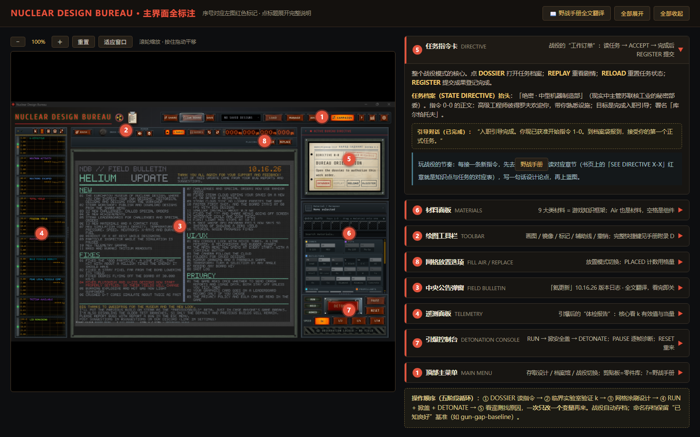
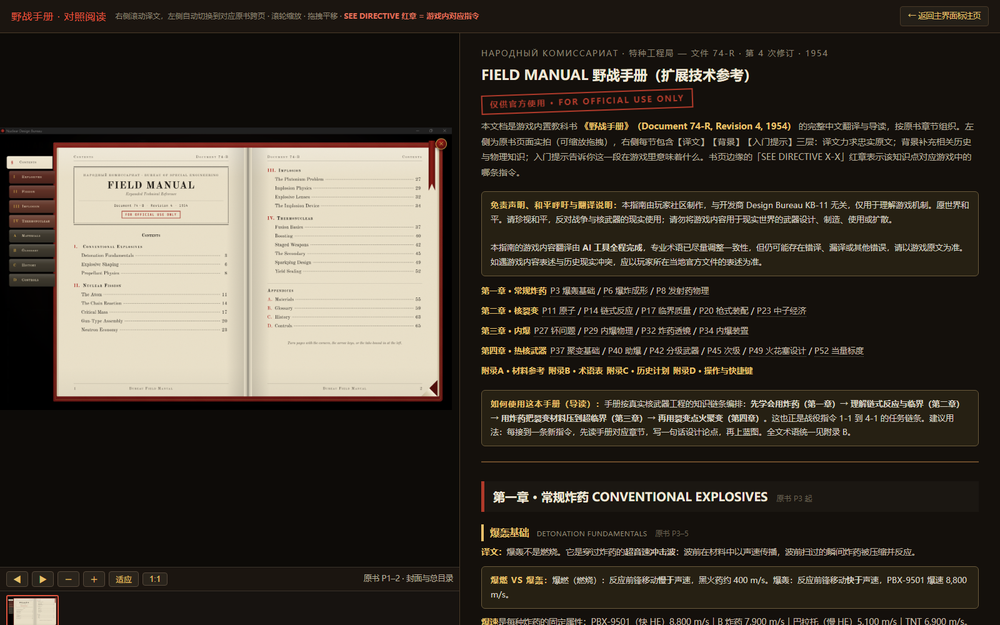

# Nuclear Design Bureau 中文指南（非官方）

《Nuclear Design Bureau》（Steam App ID: [4190240](https://store.steampowered.com/app/4190240/Nuclear_Design_Bureau/)）的非官方中文入门指南。该游戏目前仅支持英文，本仓库为中文玩家提供**游戏主界面标注说明**与**游戏内教科书（Field Manual 74-R）全文对照翻译**。

游戏处于抢先体验（Early Access）阶段，内容随版本更新变化，本指南基于 2026 年 10 月前后的版本（含 HELIUM UPDATE）制作，如有出入请以游戏内最新内容为准。

## 页面预览

| 主界面标注说明 | 野战手册对照阅读 |
|---|---|
|  |  |

## 内容

| 页面 | 说明 |
|---|---|
| [🖥️ 主界面标注说明](https://goar6.github.io/ndb-guide/) | 游戏主界面 8 大区域（工具栏 / 蓝图网格 / 材料面板 / 仪表读数 / 指令面板 / 存档与测试 / 中央公告等）的名称、翻译、作用，含入职引导对话翻译与「五阶段循环」总览，可缩放对照截图。 |
| [📖 野战手册对照阅读](https://goar6.github.io/ndb-guide/manual.html) | 游戏内教科书 Field Manual 74-R 全文（P1–68）左原文截图、右中文翻译 + 背景知识 + 入门导读。四章 + 四个附录：常规炸药 / 核裂变 / 内爆 / 热核武器 / 材料参考 / 术语表 / 历史计划 / 操作与快捷键。 |

## 本地预览

纯静态页面，推荐用内置的静态服务器：

```bash
cd ndb-guide
npm run dev
# 浏览器打开 http://127.0.0.1:7100/
```

`npm run dev` 支持 `-- --host <地址> --port <端口>` 参数转发（底层是 `server.js`，无任何第三方依赖，Node.js 即可运行）。也可以换任意静态服务器，如 `python -m http.server 8000`。

## 术语对照表（节选）

| 英文 | 中文 |
|---|---|
| k-effective | 有效增殖系数（k 值） |
| subcritical / critical / supercritical | 次临界 / 临界 / 超临界 |
| tamper | 惰层（压紧层） |
| reflector | 中子反射层 |
| pit | 弹芯 |
| explosive lens | 炸药透镜 |
| boosting | 助爆 |
| hohlraum | 黑腔 |
| sparkplug | 火花塞 |
| fizzle | 哑爆 |

## 免责声明

本指南由玩家社区制作，与开发商 Design Bureau KB-11 无关。游戏内教科书内容为游戏虚构设定，仅作学习游戏机制之用。

愿世界和平。请珍视和平，反对战争与核武器的现实使用；请勿将游戏内容用于现实世界的武器设计、制造、使用或扩散。

本指南的游戏内容翻译由 AI 工具全程完成，专业术语已尽量调整一致性，但仍可能存在错译、漏译或其他错误，请以游戏原文为准。

如遇游戏内容表述与历史现实冲突，应以玩家所在当地官方文件的表述为准。

## 许可与素材权利

本项目原创的中文标注、翻译、导读、术语整理与网页代码以 [CC BY-NC-SA 4.0](LICENSE) 发布：可自由转载、修改，须署名「NDB 中文指南贡献者」、非商业使用、相同方式共享，并保留许可链接。

游戏界面与手册截图的相关权利归 Design Bureau KB-11 或其他原权利人所有，**不适用上述许可**，本项目也未获得开发商背书。素材范围与权利边界详见 [NOTICE](NOTICE)。公开传播游戏原始素材前，请确认开发商的粉丝内容政策或转载要求。
